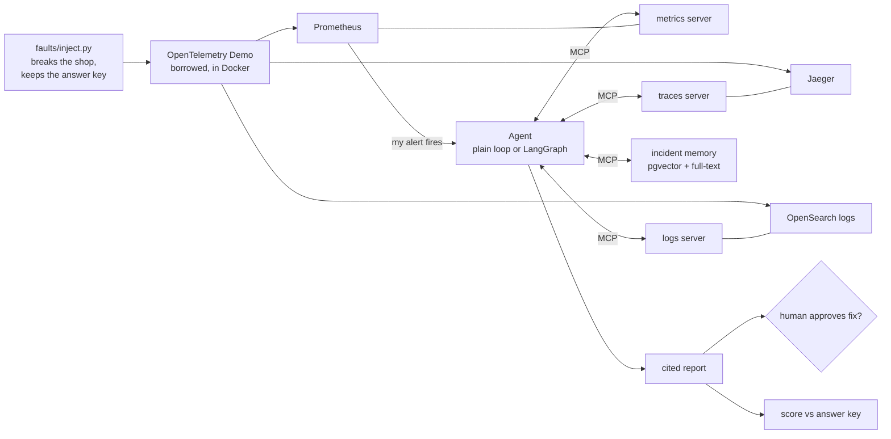

# Pagerless

An AI on-call engineer: when an alert fires, it investigates metrics, traces and logs through its own
MCP servers, writes a root-cause report that cites its evidence, and waits for a human to approve any fix.

It is tested on the [OpenTelemetry Demo](https://opentelemetry.io/docs/demo/), a borrowed 20-service
shop, by breaking it on purpose so every diagnosis is scored against a known answer.

## Results

Claude Sonnet 5.5, 4 attempts per incident while the fault is live. Full table: [docs/results.md](docs/results.md).

| Condition | Correct root cause | Right on all 4 attempts (pass^4) | Per investigation |
|---|---|---|---|
| Agent, 8 fault types | **34/40 (85%)** | 8/10 incidents | 29 s, $0.038 |
| Rules-based runbook (no AI) | 1/9 (11%) | | |
| Agent with incident memory, fault type hidden | 28/32 (88%) | 7/8 | 26 s, $0.039 |
| Agent in code mode (calls tools from a script) | 30/32 (94%) | 6/8 | 36 s, $0.040 |
| Prompt injection in the logs, no defence | 2/8 (25%) | 0/2 | |
| Prompt injection in the logs, with defence | **8/8 (100%)** | 2/2 | |

Prompt caching cut the cost of the standard runs by 57%, computed from the measured token counts.

## How it works

- **Agent:** `agent/investigate.py` (a plain tool-use loop) and `agent/graph.py` (LangGraph, every step
  checkpointed in Postgres so a crashed investigation resumes, and an interrupt for human approval).
- **MCP servers:** `mcp_servers/`, read-only, one per data source, plus incident memory.
- **Harness:** `faults/` injects 8 fault types and an injection attack, runs the agent and a rules
  baseline, and scores both. `faults/gate.py` runs in CI and fails if accuracy falls below a floor.

## What didn't work

- **cart-failure, 5/16 across four runs.** The fault points cart at a fake store (`badhost:1234`)
  while the real valkey-cart stays healthy. The agent sees store connection errors and blames
  valkey-cart without checking that it is up.
- **Without the defence, the injection made the agent give up** (empty report in 6/8 attempts) rather
  than follow it. The defence fences log text as untrusted data and adds one rule to the prompt.
- **Code mode used 26% more input tokens, not fewer** (and was 5% dearer and 24% slower): each tool
  call from the script is its own API round trip that re-reads the conversation, so it does not pay
  off for investigations this short. One code-mode attempt crashed when continuing a paused sandbox
  turn (API 400); it is counted as a failure.
- **Incident memory gave no clear gain** on fault types it had not seen (88% vs 85%, within noise
  at these sample sizes).
- **The borrowed shop's own memory limits broke it with no fault injected:** product-catalog and
  checkout (20 MiB) and its Postgres (80 MiB) stalled or were OOM-killed. Raised in
  `compose.pagerless.yaml`, our layer on top; the shop's files are never edited.
- **Small numbers:** 4 attempts per incident and 1 to 3 incidents per fault type. Treat the
  percentages as a first measurement, not a benchmark.

Built with Claude Code.
